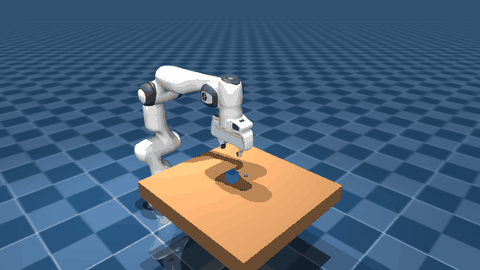
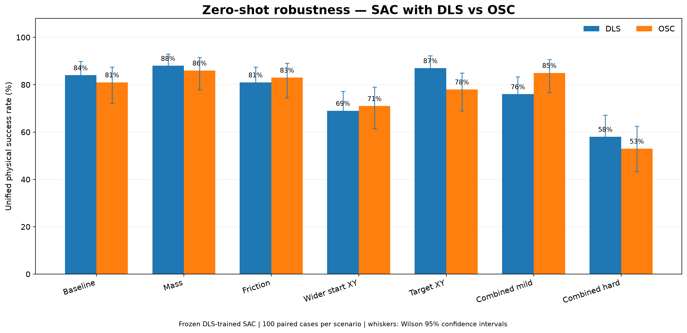
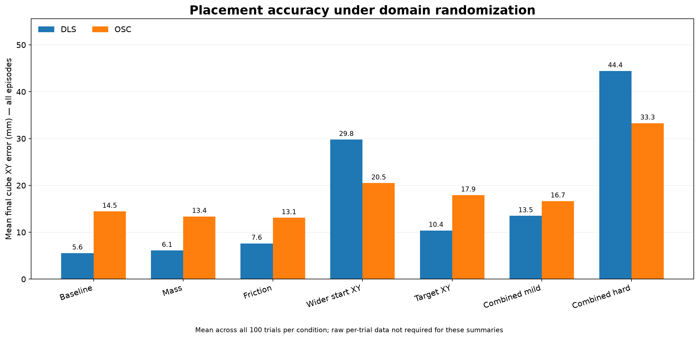
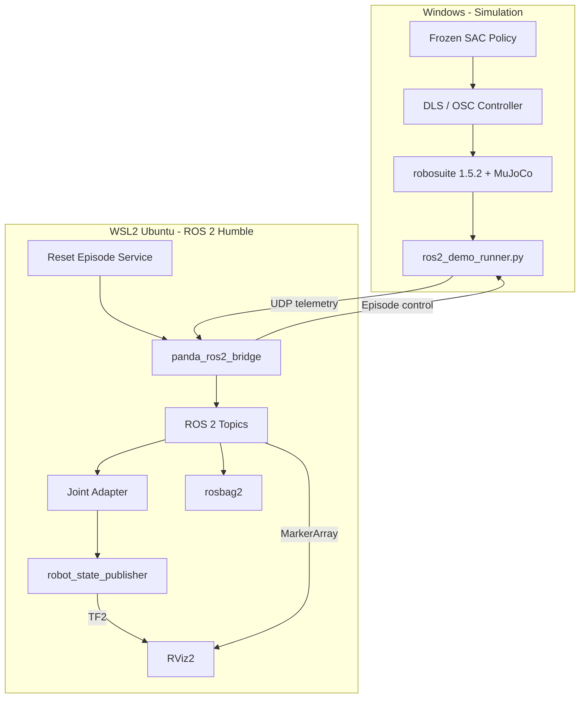
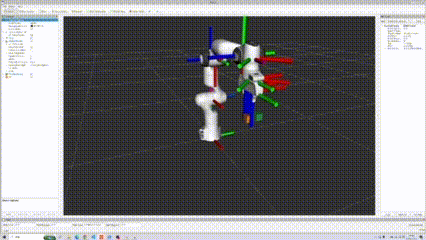
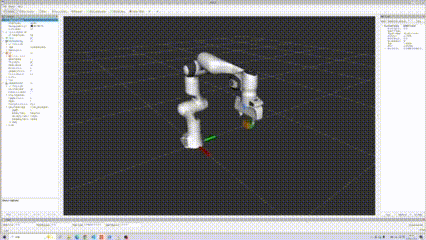

# Franka Panda Pick-and-Place — SAC + 6D DLS / OSC in robosuite

> Reproducibility note: We use the **original MuJoCo Menagerie Panda model**, not robosuite's default `Lift` Panda robot. In the OSC arm mode, the original seven joint servos are explicitly reconfigured as torque actuators while preserving force limits. The original tendon gripper is unchanged.

## Highlights / 已验证成果

| Metric |DLS | OSC_POSE |
|---|:---:|:---:|
| Frozen original SAC, 100 paired episodes, seed 42000 | **84 / 100** | **81 / 100** |
| Lift events | 100 / 100 | 99 / 100 |
| Transfer events | 100 / 100 | 99 / 100 |
| Mean final XY error | 5.56 mm | 14.46 mm |

Exact paired McNemar p-value: **0.690** (not statistically significant). Same original 46D observation and 4D action, original SAC checkpoint and independent closed-loop trajectories per controller. DLS was the training controller; this is a **zero-shot controller swap**, not separately trained DLS-versus-OSC performance bounds.

Original MuJoCo vs robosuite Menagerie DLS same-action maximum end-effector difference was approximately **0.084 mm** in the analyzed episode.

<!-- ROBOSUITE_README_MEDIA_START -->
## Demonstrations (frozen original SAC)

Both examples use the **same original 46D-to-4D SAC policy** and the **same seeded cube offset**. The low-level controllers run independent closed-loop rollouts. A case is selected only if **both pass the unified physical audit**, including the one-second post-action check. These are illustrative successful episodes, **not representative success-rate estimates**.

| SAC + original DLS position control | SAC + robosuite OSC torque control |
|:---:|:---:|
|  |  |
| [Full MP4 demo](assets/demos/sac_dls.mp4) | [Full MP4 demo](assets/demos/sac_osc.mp4) |

## Experimental results at a glance

**Zero-shot robustness: unified physical Pick-and-Place success rate** — 100 paired cases per scenario and controller. Vertical whiskers show Wilson 95% confidence intervals.



**Placement accuracy under domain randomization** — mean final cube XY error across all 100 cases in each scenario, not just successful cases.



The frozen SAC achieved **84% (DLS) vs 81% (OSC)** success under the nominal distribution, decreasing to **58% vs 53%** in the stronger combined perturbation. DLS and OSC do not show a statistically significant success-rate difference in the paired baseline comparison (exact McNemar p = 0.690). This is a **fixed SAC zero-shot controller swap** in a custom robosuite `MujocoEnv` using the original Menagerie Panda model, not the default robosuite Panda or a vision/real-robot benchmark. See [the complete V3 analysis](results/V3_ROBUSTNESS_RESULTS.md).

<!-- ROBOSUITE_README_MEDIA_END -->

## System

```text
Original single SAC Actor (46D observations -> 4D actions)
  |-- XYZ increments (+/-1 cm per 0.04 s)  + gripper continuous absolute command
  +-- DLS: original 6D Jacobian DLS -> 7 original Panda joint position servos
  +-- OSC: robosuite official OSC_POSE -> 7 joint torque actuator commands
  |-- same original tendon gripper (actuator8) in both modes
  +-- robosuite custom MujocoEnv / original Menagerie Panda MJCF
  +-- same independent physics audit (40 mm lift, 35 mm transfer,
      20 mm placement XY, no finger contact, speed, drift, 1 s post-test)
```

## Quick start (Windows PowerShell)

1. Use a Python environment with `mujoco`, `robosuite==1.5.2`, `gymnasium`, `stable-baselines3`, `scipy`, `numpy`, `matplotlib` and `torch`. For the tested setup, prefer `requirements-lock.txt` generated on the author's Windows PC.
2. Ensure `legacy_original_model/franka_emika_panda/` contains the Menagerie Panda assets and original task XML; preserve the upstream model's license.
3. Run smoke tests from this repository root:

```powershell
python smoke_sac_robosuite_exact.py
python smoke_dls_osc.py --mode both --seed 42000 --steps 5
```

Use the user's independently trained **46D/4D single SAC checkpoint** as `<your_original_sac.zip>`; this repository intentionally does not publish private model weights.

```powershell
python compare_dls_vs_osc.py --model <your_original_sac.zip> --controller both --episodes 100 --seed 42000 --post-hold target --out evaluation/controller_seed42000_v2
```

## Domain randomization 

The `run_robustness.py` script offers 7 predeclared scenarios, preserving the Actor and both controller implementations. The frozen nominal base uses **exactly** the same original XY PRNG as the 84%/81% paired benchmark.

| Factor | Baseline | Stress experiment |
|---|---|---|
| Cube mass & inertia | 1.0× | 0.6–1.4× |
| Cube + finger-pad + table contact friction | 1.0× | 0.5–1.5× |
| Cube start XY | ±4 cm | ±6 cm |
| Target XY independent perturbation | 0 cm | ±2 cm or ±3 cm |

```powershell
python run_robustness.py --model <your_original_sac.zip> --scenarios baseline,mass_random --controller both --episodes 5 --seed 42000 --out evaluation/robustness_pilot

# Full seven-scenario test; run only after local smoke/pilot passes
python run_robustness.py --model <your_original_sac.zip> --scenarios all --controller both --episodes 100 --seed 42000 --out evaluation/robustness_full
```

Windows run reported: **7 scenarios × 2 controllers × 100 episodes**. The baseline reproduces **DLS 84% / OSC 81%**; strong combined perturbation yields **DLS 58% / OSC 53%**. See [V3 results](results/V3_ROBUSTNESS_RESULTS.md) and the [results CSV](results/V3_ROBUSTNESS_SUMMARY.csv). For archival-grade release, include original raw `design.json`, `metadata.json`, `episodes.csv`, `summary.json`; terminal-text statistics alone do not enable independent recomputation.

## Verified V3 robustness results (frozen Actor, 100 paired episodes per scenario)

| Scenario | DLS | OSC |
|---|---:|---:|
| Baseline | 84% | 81% |
| Mass 0.6–1.4× | 88% | 86% |
| Contact friction 0.5–1.5× | 81% | 83% |
| Object XY ±6 cm | 69% | 71% |
| Target XY ±2 cm | 87% | 78% |
| Combined mild | 76% | 85% |
| Combined hard | **58%** | **53%** |

Only combined hard shows a robust paired decrease from baseline for both controllers after Bonferroni correction over 12 stress-vs-baseline comparisons. Controller-to-controller success-rate differences are not significant within any scenario. The presented statistics come from the author-reported console summary, pending raw artifacts in the final Release. [Full analysis](results/V3_ROBUSTNESS_RESULTS.md).

## ROS 2 Integration — Panda Digital Twin Visualization

An optional ROS 2 Humble integration layer connects the existing Franka Panda pick-and-place simulation to a ROS 2 visualization and data-recording workflow.

The frozen SAC policy and DLS/OSC controllers continue running in the original robosuite 1.5.2 + MuJoCo simulation on Windows. A UDP telemetry bridge forwards robot and task states to ROS 2 Humble running under WSL2 Ubuntu.

### Architecture




### Implemented Features

- **ROS 2 communication:** Publishes Panda joint states, end-effector pose, object pose, target pose, SAC actions, and task status.
- **Service-based episode control:** Starts a simulation episode through `/panda/reset_episode`.
- **URDF-based visualization:** Displays the complete seven-joint Franka Panda arm and two-finger gripper in RViz2.
- **TF2 integration:** Converts simulation joint states into Panda URDF joint names and publishes robot link transforms.
- **Task visualization:** Uses `visualization_msgs/MarkerArray` to display the cube, target, and end-effector trajectory.
- **rosbag2 recording and playback:** Supports offline replay of DLS and OSC trajectories.
- **Simulation-time synchronization:** Uses `/clock` and `use_sim_time` to synchronize RViz2 with recorded simulation states.

### ROS 2 Demonstrations — SAC + DLS vs. SAC + OSC

Both demonstrations show the full Franka Panda robot in RViz2, including arm motion, gripper operation, object movement, and end-effector trajectory visualization.

| SAC + DLS — ROS 2 / RViz2 | SAC + OSC — ROS 2 / RViz2 |
|:---:|:---:|
|  |  |
| [Full MP4 demo](assets/demos/panda_ros2_dls.mp4) | [Full MP4 demo](assets/demos/panda_ros2_osc.mp4) |
| DLS joint-position control | OSC operational-space torque control |

Both demonstrations visualize the existing SAC policy and low-level controllers through the ROS 2 integration layer. They are visualization examples, not additional benchmark trials.

### Environment

- Windows: Python, robosuite 1.5.2, MuJoCo, Stable-Baselines3
- WSL2 Ubuntu: ROS 2 Humble
- Visualization: RViz2, URDF, TF2, MarkerArray
- Recording: rosbag2
- Transport: UDP telemetry between Windows and WSL2

**Scope:** This integration demonstrates simulation telemetry, ROS 2 communication, visualization, and replay. It does not constitute real-robot deployment, hardware control, or a new policy-performance evaluation.

For setup instructions and terminal-by-terminal commands, see [ROS 2 Setup and Usage](ros2_ws/README.md).

## Study limitations

- Only the DLS-trained SAC checkpoint is fixed; OSC `q_cmd` observation dimensions contain a shadow DLS reference for compatibility, not an executed joint-position command.
- OSC motor actuation is torque; DLS motor actuation is position, so the comparison includes these distinct low-level execution chains.
- State-based privileged simulation observations; not a vision model or real-robot deployment.
- No BC / Diffusion Policy experiments have been completed.
- No reward shaping or success threshold was modified for the V3 robustness test.

## Documentation

See `docs/README_legacy_exact.md`, `docs/README_DLS_OSC_对照实验.md`, `docs/README_鲁棒性与GitHub发布.md` if available. `legacy_reference/` contains the original MuJoCo Stage 1–4 / SAC sources, when present; it is **not** executed by the robosuite migration. The optional `train_sac_robosuite_exact.py` fine-tunes the original single SAC, but V2/V3 zero-shot experiments do not use it.

## Licenses and attribution

The Franka Emika Panda model and meshes derive from [MuJoCo Menagerie](https://github.com/google-deepmind/mujoco_menagerie/tree/main/franka_emika_panda) (Apache-2.0); retain the model's original `LICENSE` and note derived task-scene XML modifications. Project source code requires its author's own chosen license; see `THIRD_PARTY_NOTICES.md`.
