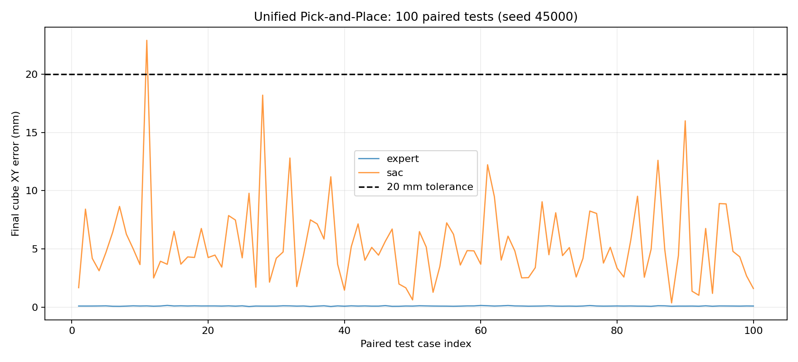

# Franka Panda Manipulation: Classical Control and Reinforcement Learning

**MuJoCo · 7-DoF Franka Panda · Cartesian DLS · SAC · Pick-and-Place**

A simulation-based robotics project that brings together joint-space control, Cartesian motion planning, 6D Jacobian damped-least-squares (DLS) control, scripted manipulation, and state-based reinforcement learning. It progresses from **Reach / Reach-and-Hold** to **Grasp-and-Lift** and a full **Pick-and-Place** task, then evaluates the learned policy against a scripted expert with a common, reward-independent physical benchmark.

> **Scope:** This is a **simulation-only, low-dimensional state-based** project. Object positions come directly from MuJoCo simulation state, not a camera or pose estimator. No real-robot deployment, vision-based manipulation, or sim-to-real generalization is claimed.

## Highlights

- Implemented Panda joint-space and Cartesian controllers, 6D pose tracking, redundancy / null-space control, and smooth Cartesian trajectories.
- Built a staged, contact-based scripted Pick-and-Place expert and a MuJoCo manipulation environment.
- Trained SAC policies for Reach, Grasp-and-Lift, and complete Pick-and-Place, including Grasp-policy initialization for Pick-and-Place fine-tuning.
- Identified a gap between **the RL environment's success flag** and **stable physical release** using a paired 100-case benchmark. The gap is reported rather than hidden.

## Main result: unified physical Pick-and-Place benchmark

The scripted expert and a selected SAC Pick-and-Place checkpoint were tested on the **same 100 paired initial cube XY offsets**, sampled within **±4 cm** per axis (offset-generator seed **45000**). Both were evaluated using the same contact/state thresholds. After each controller stopped, its **last arm and gripper control targets were held fixed** while MuJoCo advanced for an additional **1 second**; the final physical state was then checked independently of the SAC reward and termination flag.

| Metric | Scripted DLS expert | SAC + DLS |
|:--|--:|--:|
| Valid lift | 100 / 100 | 100 / 100 |
| Valid transfer | 100 / 100 | 100 / 100 |
| **Unified complete success (stable placement)** | **100 / 100** | **78 / 100** |
| Mean final cube XY error, all trials | 0.098 mm | 5.457 mm |
| Mean task simulation time | 22.00 s | 3.39 s |
| Mean drift during post-action observation | 0 mm | 0.140 mm |

**Failure analysis:** In the unified test, SAC completed lifting and transfer in every case, but **22 / 100** trials failed the final criterion: **21** involved residual gripper–cube contact after the additional observation period and **one** exceeded the XY placement tolerance. This identifies stable release as a current limitation; it does not yet establish the underlying control/dynamics cause.

The simulation-time figures describe these implementations, which have different action schedules and stopping rules; **they are not a controlled speed comparison**. The single 100-case evaluation does not imply guaranteed success outside this test distribution.



**Reproduction and data:** [Benchmark protocol and failure analysis](docs/benchmark.md) · [Per-case CSV](results/unified_benchmark/episodes.csv) · [Summary JSON](results/unified_benchmark/summary.json) · [Thresholds](results/unified_benchmark/benchmark_rules.json)

### Other experiments (different evaluation protocols)

| Experiment | Recorded result | Interpretation |
|:--|:--|:--|
| Scripted Stage 4 randomized Pick-and-Place | 50 / 50 | Earlier scripted-expert evaluation; see [`pickplace_stage4_results/`](pickplace_stage4_results/) |
| SAC Reach + 1-second Hold (V3 Corrected) | 50 / 50 | Reach-and-Hold-specific evaluation |
| SAC Grasp-and-Lift | 50 / 50 | Grasp/Lift-specific evaluation |
| SAC full Pick-and-Place, original environment-held-out test | 50 / 50; mean XY error 5.43 mm | Uses the **original environment termination criterion**, not the stricter unified post-action audit |

**Do not compare these success rates as if the protocols were identical.** The unified benchmark (78 / 100 for SAC) is the primary expert-vs-SAC outcome reported by this repository.

## Methods and project progression

1. **Classical control:** joint-space tracking, Jacobian-DLS Cartesian Reach, 6D position-and-orientation tracking, null-space objectives, and quintic Cartesian trajectories.
2. **Scripted physical manipulation:** staged approach, grasp, lift, transfer, placement, release, and retreat in MuJoCo, with randomized cube placement.
3. **Reinforcement learning:** SAC Reach and Reach-and-Hold diagnostics; contact-based Grasp-and-Lift training; Pick-and-Place training initialized from the Grasp policy.
4. **Benchmarking:** paired initial conditions, success checks independent of reward, and a post-action physical stability audit. Earlier SAC failures and updated success criteria are part of the experimental record.

The learned policy uses **XYZ displacement increments plus a gripper action**. Low-level arm commands are generated through the existing Cartesian DLS controller; this is not an end-to-end torque-control policy.

## Repository structure

The original Stage 1–4 module layout is intentionally retained to avoid breaking imports.

```text
franka-panda-manipulation/
├── README.md
├── requirements.txt
├── .gitignore
├── panda_control.py
├── panda_tracking.py
├── panda_reach.py
├── panda_random_reach.py
├── panda_3d_nullspace.py
├── panda_6d_nullspace.py
├── panda_cartesian_trajectory.py
├── panda_cartesian_trajectory_settled.py
├── panda_pickplace_stage1.py
├── panda_pickplace_stage2_grasp.py
├── panda_pickplace_stage3.py
├── panda_pickplace_stage4_random.py
├── sac_reach/                         # SAC Reach variants and ablations
├── sac_pickplace/
│   ├── panda_pickplace_env.py
│   ├── train_sac_pickplace.py
│   ├── evaluate_sac_pickplace.py
│   ├── benchmark_common.py
│   ├── benchmark_pickplace.py
│   └── test_benchmark_common.py
├── models/
│   ├── sac_reach_best.zip
│   ├── sac_grasp_best.zip
│   └── sac_pickplace_best.zip
├── pickplace_stage4_results/          # Earlier 50-case scripted evaluation
├── results/
│   ├── sac_reach/
│   ├── sac_grasp/
│   ├── sac_pickplace/
│   └── unified_benchmark/             # Paired 100-case experiment
├── docs/
├── videos/                            # Demo media, when supplied
└── mujoco_menagerie/                  # Downloaded/copied locally; Git-ignored
```

Selected model files are **Stable-Baselines3 checkpoints**. If a distributed copy of the repository does not include the weights, obtain the separately supplied checkpoints and place them at the three paths shown above. The full upstream Menagerie asset collection and intermediate training checkpoints are not committed.

## Quick start (Windows PowerShell)

Run the following from the **repository root**, for example `D:\github\franka-panda-manipulation`:

### 1. Create an environment

```powershell
python -m venv .venv
.\.venv\Scripts\python.exe -m pip install --upgrade pip
.\.venv\Scripts\python.exe -m pip install -r requirements.txt
```

### 2. Supply the Panda MJCF and assets

Option A — with GitHub connectivity, download the upstream Panda directory:

```powershell
git clone --depth 1 --filter=blob:none --sparse https://github.com/google-deepmind/mujoco_menagerie.git mujoco_menagerie
git -C mujoco_menagerie sparse-checkout set franka_emika_panda
```

Option B — if the clone fails but you already have a properly sourced, working Panda asset directory, copy its **entire** `franka_emika_panda` folder (including XML and assets) into `mujoco_menagerie/`. Record the source in [`docs/environment_versions.md`](docs/environment_versions.md). A copied directory without its original Git metadata **cannot provide a verified upstream commit**; mark it `unknown` rather than inventing one.

Check that both files exist:

```powershell
Test-Path ".\mujoco_menagerie\franka_emika_panda\panda.xml"
Test-Path ".\mujoco_menagerie\franka_emika_panda\scene.xml"
```

### 3. Verify model paths

```powershell
Get-ChildItem .\models\
Test-Path ".\models\sac_pickplace_best.zip"
```

If the last command returns `False`, supply the **full Pick-and-Place** policy checkpoint at that exact path (do not substitute the Grasp or Reach checkpoint). To reuse your own trained checkpoint, copy `sac_pickplace/results_pickplace/seed_42/best_model.zip` from the original training workspace and rename the *copy* to `models/sac_pickplace_best.zip`.

### 4. Validate the common physical auditor and run a 5-case smoke test

```powershell
.\.venv\Scripts\python.exe -m unittest discover -s sac_pickplace -p "test_*.py" -v

.\.venv\Scripts\python.exe .\sac_pickplace\benchmark_pickplace.py `
  --model "../models/sac_pickplace_best.zip" `
  --episodes 5 --seed 40000 `
  --out "results_benchmark/release_smoke_5"
```

**Path convention:** `benchmark_pickplace.py` resolves `--model` and `--out` relative to the **`sac_pickplace/` script directory**, even when called from the repository root. Thus `../models/...` correctly points to the root-level `models/`; the new smoke-test output is saved under `sac_pickplace/results_benchmark/` and is intentionally Git-ignored. Choose a fresh `--out` name if rerunning; the program rejects an existing nonempty output directory.

For the final protocol, use **100 paired cases** and seed **45000**, with a new output folder. Read [`docs/benchmark.md`](docs/benchmark.md) before interpreting or comparing scores. The curated reference results are under [`results/unified_benchmark/`](results/unified_benchmark/); running a new evaluation does not automatically overwrite them.

To run the scripted Stage 4 program separately:

```powershell
.\.venv\Scripts\python.exe .\panda_pickplace_stage4_random.py
```

Its default outputs may overwrite existing Stage 4 results; back up `pickplace_stage4_results/` or redirect the output in the script before running it.

For a more detailed Chinese guide, see [中文安装与复现说明](docs/setup_zh.md).

## Training: SAC Pick-and-Place

The complete Pick-and-Place run was initialized using a pretrained **4-action SAC Grasp-and-Lift policy** and trained for **500,000 additional environment steps** with a new replay buffer. A new run is not a bitwise replay of the published checkpoint.

From the repository root, switch into `sac_pickplace/` before starting training, so the model and output paths agree with the original script layout:

```powershell
Push-Location .\sac_pickplace
& "..\.venv\Scripts\python.exe" .\train_sac_pickplace.py `
  --pretrained "../models/sac_grasp_best.zip" `
  --steps 500000 --seed 42 `
  --eval-every 25000 --eval-episodes 20 `
  --out "results_pickplace/reproduction_seed42"
Pop-Location
```

Check `--help` and the copied training script's path handling before starting a long run. Historical evaluation curves and selected outputs are preserved in [`results/sac_pickplace/`](results/sac_pickplace/), separate from scratch-vs-pretrained experiments that have **not yet been completed**.

## Reproducibility and limitations

- **Environment provenance:** record Python, MuJoCo, Gymnasium, Stable-Baselines3, NumPy versions and the exact Menagerie source in [`docs/environment_versions.md`](docs/environment_versions.md). An unknown commit for a local-only Menagerie copy is a reproducibility limitation.
- **Task scope:** one cube, a fixed relative target (6 cm along world Y), randomized initial XY within the stated evaluation range, privileged simulation-state observations, no camera or real robot.
- **Policy limitations:** 21 residual-contact failures and one XY-tolerance failure in the 100-case strict audit. A successful original environment terminal flag is not automatically a stable physical placement.
- **Claims not yet supported:** a sample-efficiency advantage from Grasp pretraining, multi-training-seed robustness, and generalization to different object masses, friction parameters, observation noise or unseen workspaces. These require further controlled experiments.
- **Comparison limits:** completion times are reported as recorded simulation durations, not a controlled speed superiority claim.

## Attribution and licensing

The Franka Panda MJCF and mesh assets are from [Google DeepMind MuJoCo Menagerie](https://github.com/google-deepmind/mujoco_menagerie/tree/main/franka_emika_panda); retain upstream license and attribution requirements for any redistributed assets. MuJoCo, Stable-Baselines3, Gymnasium and other dependencies remain their respective authors' work.

**Project code license:** add an explicit repository-root `LICENSE` only after reviewing ownership of the included code and third-party material. Until that file is present, do **not** describe this repository as MIT- or Apache-2.0-licensed merely because the upstream robot model has its own license.
